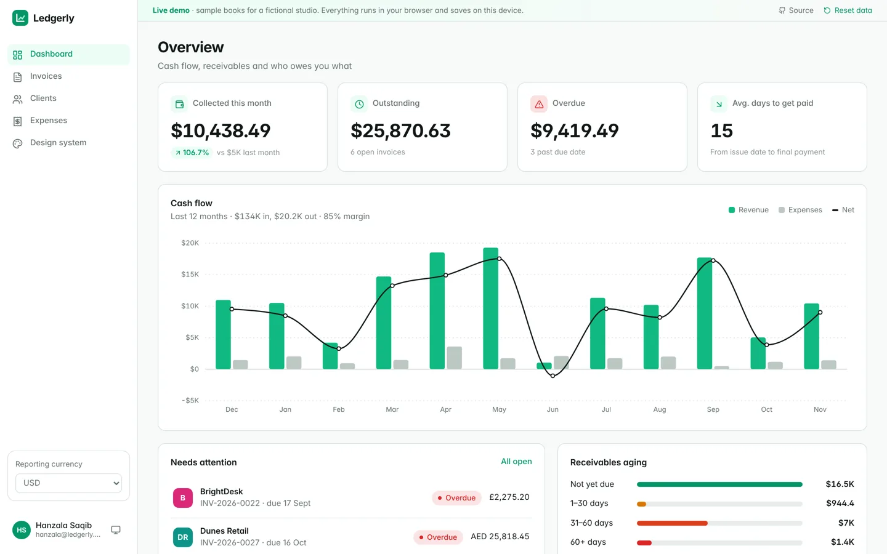
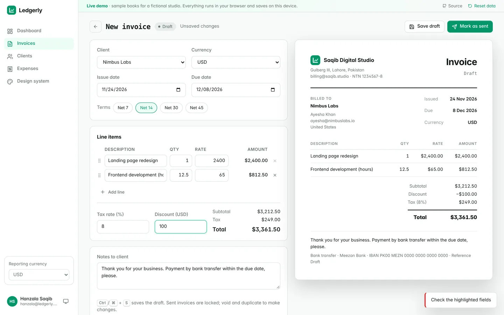
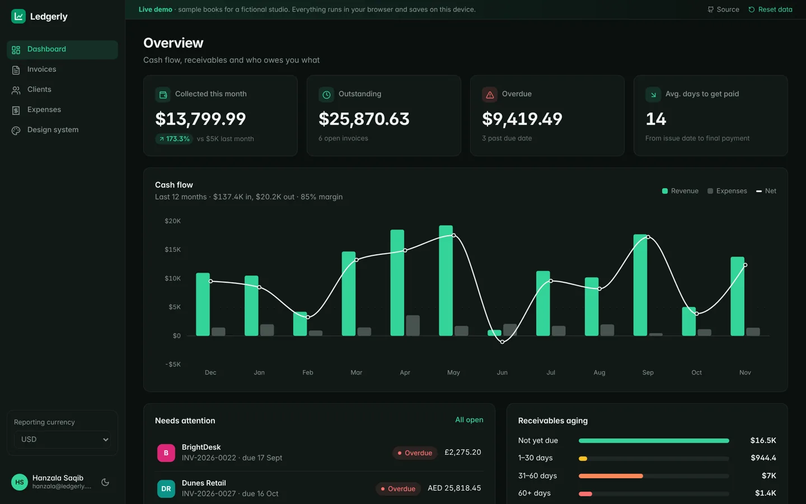
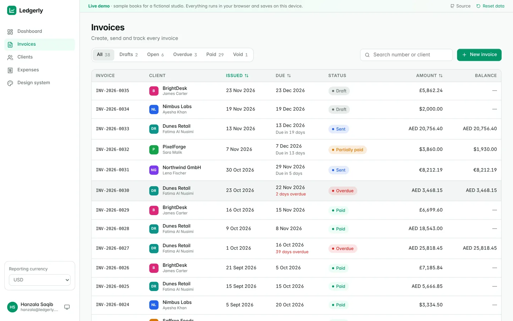
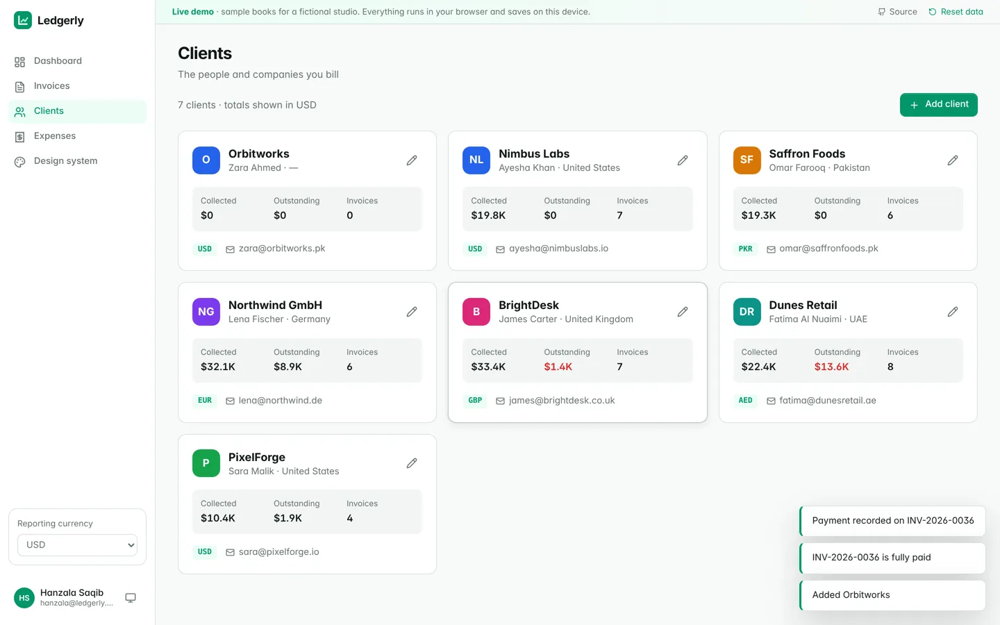
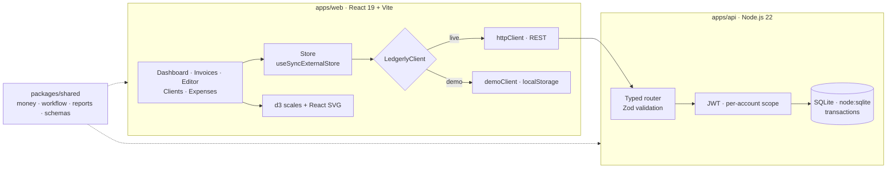

<div align="center">

# 📒 Ledgerly — Invoicing and cash flow for freelancers and studios

**Create and send invoices with a live preview, record partial payments, chase overdue clients and see cash flow at a glance. TypeScript monorepo: React 19 + d3 front end, Node.js 22 API, and shared money and workflow logic tested once and used by both.**

[](https://github.com/hanzalasqb/ledgerly/actions/workflows/ci.yml)


**[▶ Live demo](https://hanzalasqb.github.io/ledgerly/)** · runs in your browser with a year of sample books



</div>

---

## ✨ Features

| | |
|---|---|
| 📊 **Dashboard** | Collected this month vs last, outstanding, overdue, average days to get paid, a 12-month cash-flow chart (d3) with tooltips, receivables aging and top clients |
| 🧾 **Invoice editor** | Split view with an A4 preview that updates as you type, line items, Net 7/14/30/45 terms, tax, discount, notes, `Ctrl/⌘ S` to save and print-ready output |
| 🔁 **Real workflow** | Draft → Sent → Paid / Void state machine, partial payments, derived "overdue" and "partially paid", locked sent invoices, duplicate to re-bill |
| 💱 **Multi-currency** | USD, EUR, GBP, PKR and AED invoices; reporting converts everything to the currency you pick |
| 🧮 **Exact money** | Integer minor units end to end, one rounding rule, discount capped at the subtotal: no floating-point surprises |
| 👥 **Clients & expenses** | Client cards with collected and outstanding totals, expense log with category breakdown |
| 🔐 **Secure API** | Scrypt + JWT auth, rate-limited sign-in, strict per-account data isolation, Zod validation with field-level errors |
| 🎨 **Design system** | W3C design tokens (Figma-ready), generated CSS variables, light / dark / system themes, living style-guide page |
| 📱 **Responsive** | Invoice table turns into cards on phones; the editor stacks the form above the preview |

<table>
<tr>
<td width="50%"></td>
<td width="50%"></td>
</tr>
<tr>
<td width="50%"></td>
<td width="50%"></td>
</tr>
</table>

## 🏗️ Architecture



**Decisions worth noting**

- **Money is integers.** Every amount is stored in minor units (cents, paisa). `invoiceTotals()` rounds each line once, half away from zero, then applies the discount (capped at the subtotal) and tax. The same function prices the editor preview, the API and the reports, and it is unit-tested.
- **Workflow is data.** Allowed transitions live in one table (`draft → sent | void`, `sent → paid | void`). Paid is only reached by recording payments that add up to the total. Overdue and partially paid are derived from the due date and payments rather than stored, so they can never go stale.
- **Reports are pure functions.** `summarize()` and `cashFlow()` take invoices, expenses, a base currency and "today", so the dashboard, the `/api/reports/summary` endpoint and the tests all share one implementation with an injectable clock.
- **Tenant isolation by construction.** Every query in the data layer takes the owner id, and an integration test proves one account can't read or bill another's clients.
- **One contract, two runtimes.** The UI talks to a `LedgerlyClient` interface. The live demo swaps in a browser implementation that enforces the same schemas and workflow rules.

## 📁 Project structure

```text
ledgerly/
├── apps/
│   ├── api/                  # Node.js 22 REST API
│   │   ├── src/app.ts        # routes, auth, security headers, CORS
│   │   ├── src/db.ts         # SQLite schema + owner-scoped data access
│   │   ├── src/http.ts       # typed router, JSON parsing, error shape
│   │   ├── src/auth.ts       # scrypt, JWT, rate limiter
│   │   └── test/             # unit + integration tests (node:test)
│   └── web/                  # React 19 + Vite
│       └── src/
│           ├── pages/        # Dashboard, Invoices, InvoiceEditor, Clients, Expenses, DesignSystem
│           ├── charts/       # CashFlowChart (d3-scale, d3-shape)
│           ├── components/   # InvoicePaper, dialogs, pills, fields
│           └── api/          # LedgerlyClient, http + demo clients
├── packages/shared/          # money math, Zod schemas, workflow, reports, demo data
├── design/tokens.json        # design tokens (W3C format, Figma-ready)
└── scripts/build-tokens.mjs  # tokens.json → CSS custom properties
```

## 🚀 Getting started

Requires **Node.js 22.13+**.

```bash
git clone https://github.com/hanzalasqb/ledgerly.git
cd ledgerly
npm install

npm run dev:demo                          # UI only, same as the live demo → http://localhost:5173

cp apps/api/.env.example apps/api/.env    # set JWT_SECRET (32+ characters)
npm run seed -w @ledgerly/api             # optional: a year of sample books
npm run dev                               # API on :4000, web on :5173
```

**Docker:** `JWT_SECRET=$(openssl rand -base64 48) docker compose up --build` → http://localhost:8080

| Command | What it does |
|---------|--------------|
| `npm test` | 17 unit + integration tests: money, workflow, reports, full invoice lifecycle, tenant isolation |
| `npm run typecheck` | Strict `tsc` for API, web and shared |
| `npm run build` | esbuild bundle for the API, Vite build for the web app |
| `npm run tokens` | Regenerates `tokens.css` from `design/tokens.json` |

## 🔌 API

| Method | Endpoint | Description |
|--------|----------|-------------|
| `POST` | `/api/auth/register` · `/api/auth/login` | Account and JWT (rate limited) |
| `GET` `POST` | `/api/clients` | List / add clients |
| `PUT` | `/api/clients/:id` | Update a client |
| `GET` `POST` | `/api/invoices` | List / create a draft (numbered `INV-YYYY-NNNN`) |
| `GET` `PUT` `DELETE` | `/api/invoices/:id` | Read / edit (drafts only) / delete (drafts only) |
| `POST` | `/api/invoices/:id/send` · `/void` | Workflow transitions (`409` if not allowed) |
| `POST` | `/api/invoices/:id/payments` | Record a payment; the full balance marks it paid |
| `POST` | `/api/invoices/:id/duplicate` | New draft dated today with the same terms |
| `GET` `POST` `DELETE` | `/api/expenses` | Expense log |
| `GET` | `/api/reports/summary?base=USD` | KPIs, aging, 12-month cash flow, top clients |

Errors are consistent: `{ "error": "Validation failed", "issues": [{ "path": "items.0.description", "message": "Describe the item" }] }`.

## 🎨 Design system & Figma

`design/tokens.json` uses the [W3C Design Tokens](https://www.designtokens.org/) format, so **Tokens Studio for Figma** can load it as a Figma library. `npm run tokens` turns the same file into CSS variables. Primitives (emerald, ink…) map to semantic tokens (`--color-surface`, `--color-chart-revenue`, `--color-danger`…), and components only use semantic tokens. The in-app **Design system** page renders the palette, type scale, spacing, radii, shadows and core components.

> Exchange rates in `packages/shared/src/money.ts` are fixed, indicative values for reporting. Swap `USD_RATE` for a rates API in production.

## 🗺️ Roadmap

- [ ] Email invoices with a hosted pay link (Stripe)
- [ ] Recurring invoices and automatic reminders
- [ ] PDF generation on the server
- [ ] PostgreSQL adapter behind the same store interface

## 📄 License

MIT © [Hanzala Saqib](https://github.com/hanzalasqb)
